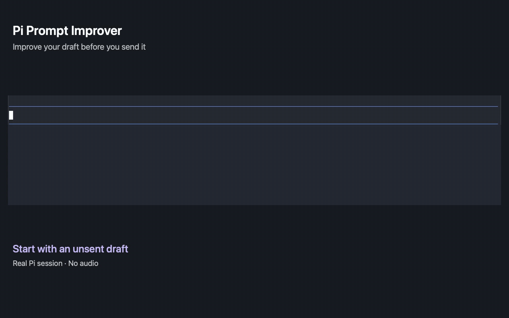

# Pi Prompt Improver

Pi Prompt Improver uses your selected AI model to rewrite drafts in Pi's editor. Each rewrite calls the model's provider and uses tokens. It isn't an offline text edit. You preview the rewrite before replacing your draft. The extension never submits your draft or adds its request and response to your main conversation.

Inspired by prompt improvement in early versions of Augment Code and Kilo Code.

[](docs/media/demo.mp4)

[Watch the sharper MP4](docs/media/demo.mp4).

## Try without installing

You need Pi **0.99.1** or newer and Node **22.19.0** or newer.

```bash
pi -e git:github.com/delmicio/pi-prompt-improve
```

Pi downloads the package and loads it for that session without adding it to your saved package list. Any improver settings you change still save globally.

## Install

Install from `main`:

```bash
pi install git:github.com/delmicio/pi-prompt-improve
```

Then restart Pi or run `/reload`.

Updates are manual. To get the latest `main`, run the command below, then restart Pi or run `/reload`:

```bash
pi update --extensions
```

To pin version `0.1.0`:

```bash
pi install git:github.com/delmicio/pi-prompt-improve@v0.1.0
```

A tagged install stays on that tag. To upgrade, install a newer tag.

## Improve a draft

1. Type a draft in Pi's editor.
2. Press `Cmd+I` (`super+i`). If your terminal doesn't pass that key, press `Ctrl+Shift+I`.
3. A preview shows the improved text. Your original draft stays in the editor.
4. Choose what to do:
   - `Enter` replaces your draft with the rewrite. It only works if you haven't changed the draft since you started. You can undo the replacement with the editor's normal undo.
   - `R`, `Cmd+I`, or `Ctrl+Shift+I` tries again. Each retry reuses exactly what the first attempt captured: the same original draft, model, thinking level, guidance, protocol, context, and Fast mode setting. You can retry as many times as you like. Each retry is a new provider request.
   - `Esc` keeps your original draft.

`Esc` or `Ctrl+C` also cancels while the rewrite is still being set up or generated. The UI closes right away and your draft stays as it was.

You can improve a draft while Pi is busy with another run. The extension takes a snapshot of the finalized context and active model when you press the key. It doesn't stop or cancel the main run. After you replace the draft, pressing `Enter` sends it as steering if Pi is still running, or starts a normal turn if Pi has finished.

## Commands and settings

- `/prompt-improve` opens settings.
- `/prompt-improve status` shows the settings in effect.
- `/prompt-improve reset` restores the defaults after you confirm.

Settings and reset only work while Pi is idle. Status works at any time.

By default the extension uses:

- the active session model
- the model's default thinking level
- Fast mode off
- no recent context
- the built-in rewrite guidance

In settings you can change:

- **Model.** Follow the active session model, or pick a fixed authenticated model. A fixed model doesn't change your main session model.
- **Thinking.** Use the model default or pick a supported level.
- **Fast mode.** Off by default. Only available for OpenAI Codex models (see [Fast mode](#fast-mode)).
- **Rewrite guidance.** Edit the instructions in a multiline editor. Your text replaces the default guidance. It does not replace the fixed rewrite protocol. `Esc` discards your edit. Blank guidance is rejected.
- **Recent context.** Off by default. When on, the extension includes the last N user and assistant messages. N counts both kinds together, defaults to 4, and has no set maximum.

Settings are global and live in `~/.pi/agent/prompt-improve.json`. Each change saves immediately, and the extension writes the file atomically. If a model change would make your thinking or Fast mode setting invalid, the extension asks before changing them.

If the settings file is malformed, improvement turns off and the extension leaves the file untouched. `/prompt-improve reset` replaces it only after you confirm.

## Privacy and cost

Each attempt sends your full draft and rewrite guidance to the provider of the selected model. If you turned on recent context, it sends that too. A fixed model may belong to a different provider than your main session. Every retry is another request that uses quota or costs money.

Recent context is opt-in. It includes text only from finalized user and assistant messages on Pi's current branch, after compaction. It leaves out images, tool calls, tool results, thinking, queued messages, and any response still streaming.

The extension doesn't read files named in your draft and doesn't attach images. File paths are sent as plain text.

The extension never silently trims context. If the provider says the request is too large, your draft stays unchanged. With context enabled and N set to 20 or more, it shows a warning about cost and data sharing once per logical session.

The extension doesn't log your draft, guidance, or session context. Providers may echo request text in errors, so the extension shows a generic error instead of the raw provider error.

## Limitations

- Improvement and settings need Pi's interactive TUI. RPC, JSON, and print modes don't support them.
- `Cmd+I` only works if your terminal reports the Super modifier. Use `Ctrl+Shift+I` if it doesn't.
- Some providers ignore cancellation and may keep working, or charging, in the background after the UI closes. Their late results are discarded and can't replace your draft.
- Always review the rewrite. Model instructions can't guarantee the rewrite keeps your intent, and they don't protect against prompt injection hidden in the context.
- Automated tests cover cancellation, retries, editor conflicts, Unicode rendering, and native undo. Manual terminal and live-provider checks passed for the `0.1.0` candidate.

## How it works

### Rewrite protocol

The extension sends one user turn that asks for a transformation. It does not replay recent messages as a live conversation. This protocol is fixed and you can't configure it. It:

- sends recent user and assistant text as reference data, labeled by role;
- wraps the draft in boundaries that can't collide with its content;
- names the draft as the only thing to rewrite;
- tells the model never to answer, execute, or continue the context or the draft;
- asks for only the rewritten prompt.

Custom guidance changes style and what to preserve, but it can't remove the protocol. `/prompt-improve status` reports that the protocol is active without printing your full guidance.

### Models and credentials

The extension reads Pi's cached list of authenticated models and never refreshes it. If you change `models.json` or provider login, open `/model` so Pi reloads the list. Credentials are resolved only when you invoke an improvement.

With **Model default** thinking, the extension calls a native extension provider's raw stream if one is registered. Otherwise it uses Pi's built-in `ModelRegistry.complete()`. Without a registered native provider, a legacy `streamSimple` overlay for the model's API blocks Model default, both in status and when you invoke it. These overlays can change default-thinking behavior, for example when shaping Anthropic OAuth requests. Pick an explicit thinking level instead. Explicit levels go through Pi's full provider stack.

Cursor SDK models (the `cursor-sdk` API) aren't supported. They share Pi's active session provider state, so the extension can't isolate its request. Pick a different improver model, even if Cursor works in your main session.

If a saved thinking level or Fast mode isn't supported, or the saved model is missing, the extension stops with an error. It never falls back to another setting.

### Fast mode

Fast mode only works with OpenAI Codex models that use the Codex Responses API. When it's on, the extension requests Fast mode on every attempt and retry, and status shows `Fast mode: requested`. When it's off, the extension adds no Fast mode option to the request and no status line. Fast mode may use credits or tokens at a higher rate. OpenAI decides eligibility and may downgrade the request.

### Startup

Startup checks don't block Pi.

## Development

```bash
npm ci
npm run check
npm audit
npm pack --dry-run
pi -e ./index.ts
```

`pi -e ./index.ts` runs Pi with your local copy of the extension. CI runs the first four checks on Node 22 and 24, with no credentials and no paid model calls. Dev dependencies pin Pi 0.99.1. Peer dependencies stay `"*"` because Pi provides its own packages.

Add regression tests for fixes, and record user-visible changes in `CHANGELOG.md`.

After publication, report issues on GitHub. Include your Pi, Node, OS, terminal, and provider/model versions, plus a synthetic draft that reproduces the problem. Don't share credentials, private drafts, settings files, or full session logs.

## License

[MIT](LICENSE).
